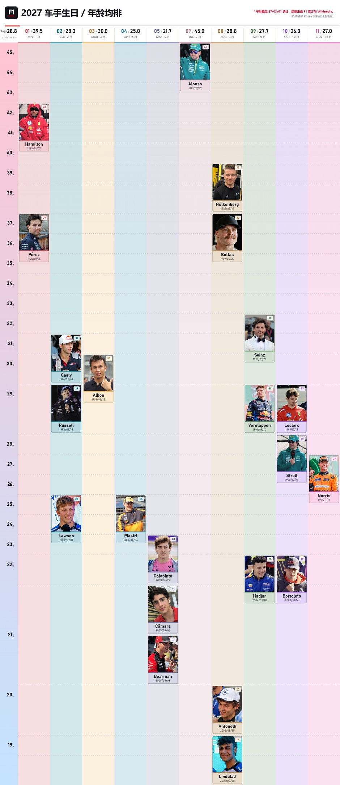
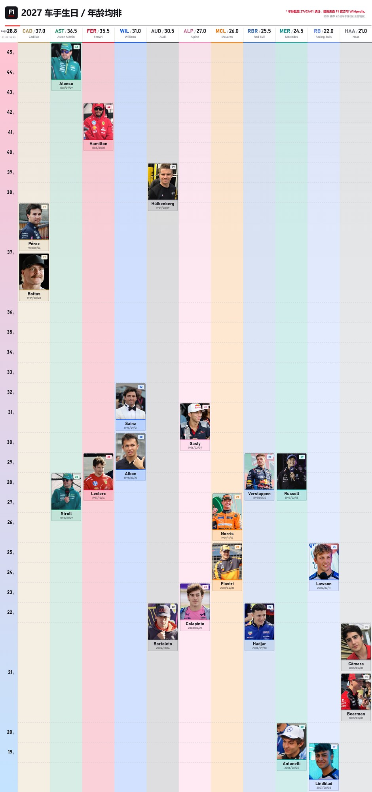
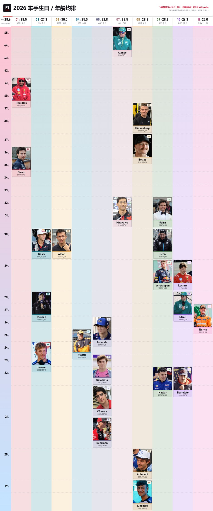
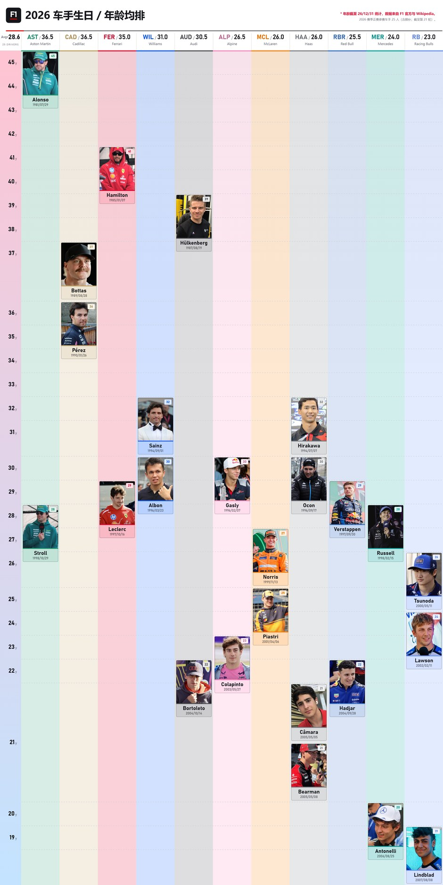

# F1 2027 车手生日 / 年龄均排

参考「声优生年 / 年龄均排」信息图做的 F1 版本：**默认横轴为出生月份（参考图同款），纵轴为周岁，卡片里是车手照片、姓名与完整生日**。默认展示 2027 赛季 22 位车手；分组切到「车队」即可换成 F1 视角的 11 队平均年龄视图。右上角赛季下拉 / 「车手数据」顶部还能切到 **2026 赛季**（25 位实际参加过正赛的车手，含替补）。

版式按参考图重做过一轮：**整版满铺无白边、连续年龄刻度（45→19 每年一行）、扁平卡片（细边框 + 照片压边）、饱和的列底色与列顶色条、无页脚/无副标题**。默认「生日月份」画布 1224 × 2814，2× 导出 2448 × 5628；「车队」视图画布 1340 × 2849。如果觉得太松或太紧，右侧「卡片占列宽 / 字号 / 纵向密度」三个滑杆可以直接微调。

> 参考图有约 100 个人物，本图只有 22 位车手，所以列内留白天然更多；版式上已经通过缩小行距、放大卡片、连续年龄刻度来把这份稀疏感压到最低。

- 纯静态、零依赖，双击 `index.html` 即可打开
- 照片、主题、排序、分组、标题、注释、配色都可调
- 点击画布上的卡片直接编辑；拖一张照片到卡片上即可换图
- 一键导出 PNG / JPEG（最高 3×），或复制到剪贴板
- 所有改动自动保存在本机浏览器；可导出 / 导入 JSON，或保存为命名「数据集」



右侧分组切到「车队」即可换成 F1 视角的 11 队视图：



### 2026 赛季（内置）

顶部赛季下拉 / 「车手数据」顶部切到 2026：25 位实际参加过 2026 正赛的车手，含替补 Ocon、Hirakawa、Tsunoda；年龄截至 2026-12-31；车队视图 Haas 4 人、Racing Bulls 3 人。





### 视频动画

**大字可读版（推荐）**：20 秒、1080 × 1920 / 60fps 的卡片流。固定表头，每张卡片 940 × 270，名字 36px、生日 22px、年龄 42px；22 位车手按 19 → 45 岁从下往上依次滚入；浅色、无黑场。

[▶ 大字卡片流（MP4）](exports/f1-2027-driver-feed.mp4)

**整张海报组装版**：14 秒、1080 × 2482 / 60fps，整张海报从空白到全部卡片弹出。全图可见，但卡片字小，适合大屏。

[▶ 整张海报组装版（MP4）](exports/f1-2027-age-chart-reveal.mp4)

- 页面右上角 ▶ 指向大字卡片流；导出区可下载两版
- 生成工程在 [`video/`](video/)：`F1Feed`（卡片流）、`F1Reveal`（海报组装）

---

## 快速开始

下面两种方式任选：

```powershell
# 1) 直接打开（无需服务）
start index.html
# 或双击 start.cmd

# 2) 本地服务（推荐，便于以后加载外部图片）
node serve.mjs 4173
# 打开 http://127.0.0.1:4173/
```

> 不需要 `npm install`。项目没有构建步骤，所有脚本都是普通 `<script>`，照片以 data URL 内嵌，所以 `file://` 下也能正常导出图片。
> 如果浏览器禁止 `file://` 使用 localStorage，页面仍可正常显示和导出，只是设置不会自动保存；此时用 `serve.mjs` 即可。

## 界面操作

| 操作 | 说明 |
| --- | --- |
| 右上角赛季下拉 / 数据区顶部 | 切换 2027（22 位官宣）/ 2026（25 位实际正赛参赛者，含替补）；切换会载入内置阵容 |
| 右上角 ▶ / 导出区「下载 MP4」 | 播放大字卡片流（20 秒 / 1080×1920）；导出区也提供整张海报组装版（14 秒 / 1080×2482） |
| 点击卡片 | 打开车手编辑器（姓名、中文名、车队、国籍、生日、席位状态、照片与裁剪、高亮） |
| 把图片拖到卡片 | 直接替换该车手照片（压缩后写入本地存储） |
| 右上「导出 PNG」 | 按右侧倍率导出完整海报 |
| 「复制图片」 | 写系统剪贴板（需要浏览器支持 ClipboardItem） |
| 左上「恢复默认」 | 恢复 2027 阵容、配色和全部版式 |
| 右侧「版式与排序」 | 分组维度、列排序、年龄基准日、卡片大小、卡片占列宽、字号、纵向密度、照片/角标/国籍/色带/渐变开关 |
| 「生日月份」 | **默认视图**：横轴是出生月份，列标题为 `月份 / 该月平均年龄`（参考图同款） |
| 「车队」 | F1 视角：横轴 11 支车队，列标题为 `车队代码 / 平均年龄` |
| 「紧凑行」 | 默认关闭（连续年龄轴，45→19 每年一行）；勾选后只保留有车手的年龄，海报更短 |
| 「生日月份」 | 参考图同款分组：横轴变成出生月份，列标题为 `月份 / 该月平均年龄` |
| 「车手数据」 | 增删改车手；导入/导出 JSON；保存/载入本机数据集 |
| 预览缩放 | 45%–160%，100% = 适应宽度；导出尺寸与它无关 |

## 默认数据

- 阵容：2027 赛季 22 位车手，**22 席已全部官宣（Oliver Bearman 已续约确认）**；默认不再显示 `?`。
- 年龄基准日：`2027-03-01`（可在面板改成任意日期，逐日计算周岁；「今天」按钮会取本机日期）。
- 生日与阵容来源：[F1 官方](https://www.formula1.com/) 与 [Wikipedia](https://www.wikipedia.org/)；2027 阵容参考 [Times of India 汇总](https://timesofindia.indiatimes.com/sports/racing/f1-2027-driver-line-up-racing-bulls-confirm-lawson-and-lindblad-full-list-of-confirmed-racers-for-all-11-teams/articleshowprint/135775061.cms)。
- 照片：Wikimedia Commons / Wikipedia 人物图，来源与许可见 [CREDITS.md](CREDITS.md)；可在界面中随时替换。

默认值（以 2027-03-01 计）：

| 车队 | 车手 | 平均年龄 |
| --- | --- | ---: |
| Cadillac | Pérez 37 / Bottas 37 | 37.0 |
| Aston Martin | Alonso 45 / Stroll 28 | 36.5 |
| Ferrari | Leclerc 29 / Hamilton 42 | 35.5 |
| Williams | Albon 30 / Sainz 32 | 31.0 |
| Audi | Hülkenberg 39 / Bortoleto 22 | 30.5 |
| Alpine | Gasly 31 / Colapinto 23 | 27.0 |
| McLaren | Norris 27 / Piastri 25 | 26.0 |
| Red Bull | Verstappen 29 / Hadjar 22 | 25.5 |
| Mercedes | Russell 29 / Antonelli 20 | 24.5 |
| Racing Bulls | Lawson 25 / Lindblad 19 | 22.0 |
| Haas | Câmara 21 / Bearman 21 | 21.0 |

### 2026 赛季数据（可选）

- 范围：实际参加过 2026 正赛的 **25 人**（22 位常规 + 替补 Ocon / Hirakawa / Tsunoda）；截至第 21 轮，Las Vegas 尚未进行。
- 替补：Ocon（Haas，1–19）、Hirakawa（Haas，第 19 轮 Mexico）、Câmara（Haas，第 20 轮起替 Ocon）、Tsunoda（Racing Bulls，3 场替 Lawson）；Lawson 另有 3 场替 Hadjar 跑 Red Bull；Hadjar 伤缺 3 场。
- 年龄基准：`2026-12-31`；车队视图 Haas 4 人（Ocon / Hirakawa / Câmara / Bearman）、Racing Bulls 3 人（Lawson / Lindblad / Tsunoda）。
- 车队平均年龄（2026-12-31）：Cadillac 36.5、Aston 36.5、Ferrari 35.0、Williams 31.0、Audi 30.5、Alpine 26.5、McLaren 26.0、Haas 26.0、Red Bull 25.5、Mercedes 24.0、Racing Bulls 23.0。
- 数据来源：Wikipedia 2026 赛季 Entries / In-season changes；照片来源见 [CREDITS.md](CREDITS.md)。

## 可调整项

**分组与排序**

- 分组：生日月份（默认，参考图同款）/ 车队 / 国籍 / 出生年代
- 排序：平均年龄高→低、低→高、名称 A→Z / Z→A、人数多→少、手动顺序
- 手动顺序：选择「手动顺序」后，在面板里拖动列表调整列序
- 行：默认连续年龄轴（45→19 每年一行）；勾选「紧凑行」只显示有人的年龄

**版式**

- 卡片大小：整体缩放（同时改变整张海报的宽高）
- 卡片占列宽：70–97%，默认 92%——控制卡片左右留白
- 字号：85–130%，默认 108%——同时作用于卡片姓名/生日、列头与年龄刻度
- 纵向密度：30–100%，默认 40%——控制年龄行的松紧。低于 100% 时卡片会比一行略高、跨过虚线，这是参考图的排法；同一列相邻年龄若发生冲突，整行会自动下推，保证年龄标签仍对得上
- 卡片姓名：英文姓氏 / 中文名 / 英文全名
- 照片、年龄角标、国籍、顶部车队色带、左侧渐变轴分别可关；国籍默认关闭
- 标题、副标题（默认留空）、右上两行注记（支持 `{date}` / `{iso}` 占位）
- 「在海报底部显示数据信息」默认关闭；打开后会恢复一条页脚

**主题与配色**

- 粉彩（参考原图）/ 暖纸 / 夜赛深色
- 每支车队的强调色可改（实时影响列底色、卡片、列标题）
- 可新增 / 删除车队（删除前需先把车手换队）

**导出**

- PNG / JPEG；1× / 1.5× / 2× / 3×；JPEG 质量 70–100
- 实际像素会受 12000 px 单边、72 MP 上限保护自动下调，面板会显示实际倍率
- 导出始终使用完整分辨率，和预览缩放无关

## 扩展

### 1. 换阵容 / 换赛季

推荐直接改数据：右侧「车手数据」→「导出 JSON」，编辑后「导入 JSON」。也可以把 JSON 保存成数据集（存在浏览器里）随时切换。

JSON 结构（省略部分字段时自动补默认值）：

```json
{
  "schema": 2,
  "season": 2027,
  "asOfDate": "2027-03-01",
  "title": "2027 车手生日 / 年龄均排",
  "subtitle": "",
  "cardScale": 1,
  "cardFill": 0.92,
  "verticalDensity": 0.4,
  "fontScale": 1.08,
  "compactRows": false,
  "showCountry": false,
  "showBand": false,
  "showFooter": false,
  "groupBy": "month",
  "sortMode": "labelAsc",
  "teams": [
    { "id": "mclaren", "name": "McLaren", "code": "MCL", "accent": "#FF8000" }
  ],
  "drivers": [
    {
      "id": "norris",
      "name": "Lando Norris",
      "shortName": "Norris",
      "nameZh": "诺里斯",
      "teamId": "mclaren",
      "country": "GBR",
      "birthday": "1999-11-13",
      "status": "confirmed",
      "highlight": false,
      "photo": null,
      "photoFocus": { "x": 0.5, "y": 0.35, "z": 1 }
    }
  ]
}
```

- `birthday` 必须为 `YYYY-MM-DD`，否则该车手会被计入「生日待补充」。
- `status: "pending"` 会在卡片姓名后显示 `?`。
- `highlight: true` 会给卡片加一圈洋红色描边。
- `photo` 可填 data URL（推荐，导出不受跨域限制）或同源图片路径。
- `photoFocus` 控制裁剪：`x/y` 为 0–1 的焦点，`z` 为 1–2.4 的放大倍数。

文件名示例：`data/2027-season.json` 是默认数据的一份导出样例，`data/2026-season.json` 是 2026 内置阵容的导出样例，都可通过「导入 JSON」载入。

### 2. 新增分组方式

分组是注册表，`js/groups.js` 末尾追加即可，面板下拉会自动出现：

```js
F1.groups.register('teamPrincipal', {
  label: '领队',
  hint: '按领队分组',
  build(state) {
    // 返回 [{ key, title, subtitle, label, accent, drivers }]
    return Object.values(
      state.drivers.reduce((acc, d) => {
        const key = 'tp:' + (d.teamId || 'none');
        (acc[key] ||= {
          key,
          title: (d.teamId || 'N/A').toUpperCase(),
          subtitle: '自定义',
          label: key,
          accent: '#8A8F98',
          drivers: [],
        }).drivers.push(d);
        return acc;
      }, {})
    );
  },
});
```

注意：`build` 里只返回「列」，行与卡片位置由 `js/layout.js` 统一计算。

### 3. 新增主题

`js/themes.js` 里 `register(id, {...})`，至少提供：

```js
F1.themes.register('mono', {
  label: '黑白',
  bg: '#ffffff', ink: '#111111', muted: '#666666', faint: '#999999',
  hairline: '#e5e5e5', dash: '#cccccc', headerRule: '#111111',
  axisTop: '#f0f0f0', axisBottom: '#d8d8d8', axisText: '#111111',
  cardBorder: 'rgba(0,0,0,.14)', cardShadow: 'rgba(0,0,0,.12)',
  photoPlaceholder: '#f2f2f2', noteInk: '#b00020', bandBase: '#111111',
  labelMuted: 'rgba(0,0,0,.58)',
  columnTint: (a) => F1.util.mix(a, '#ffffff', 0.9),
  cardTint: (a) => F1.util.mix(a, '#ffffff', 0.82),
  photoBg: (a) => F1.util.mix(a, '#ffffff', 0.93),
  textAccent: (a) => F1.util.mix(a, '#111111', 0.2),
  badgeBg: (a) => F1.util.mix(a, '#ffffff', 0.88),
});
```

主题会自动出现在「配色主题」下拉里，并立即参与预览和导出。

### 4. 照片

- **在界面里换**：点卡片 → 「选择照片」，拖拽/缩放滑杆调整裁剪 → 保存。照片会压缩到 420 px 宽并以 data URL 写入 localStorage。
- **批量换**：替换 `assets/photos/<driver-id>.jpg` 后运行（需要 Pillow）：

```powershell
python tools/build_photos.py
```

脚本会重新生成 `js/photos.js`（340 px 宽、JPEG 82，约 0.9 MB），车手 id 与文件名一致即可自动匹配。

### 5. 导出 / 渲染 API

控制台里可直接调用：

```js
// 导出完整海报（返回 { blob, width, height, name }）
await F1.exporter.exportImage(F1.state, { format: 'png', scale: 2 });

// 只渲染到 canvas，不下载
const { canvas, geom } = await F1.exporter.renderCanvas(F1.state, 2);

// 当前预览的几何信息（列、行、卡片矩形），可用来做交互扩展
F1.app.getGeom();
```

`F1.exporter.renderCanvas` 会等待所有照片加载完成，并自动套用导出尺寸上限。

## 文件结构

```
F1driver-age/
├─ index.html            页面骨架与控件
├─ styles/app.css        界面样式（不是海报样式；海报在 canvas 里画）
├─ js/
│  ├─ util.js            颜色/文字/图片/下载等工具
│  ├─ photos.js          22 张照片的 data URL（生成文件）
│  ├─ data.js            默认车队与车手数据
│  ├─ age.js             周岁、日期格式化
│  ├─ themes.js          主题注册表
│  ├─ groups.js          分组策略注册表
│  ├─ layout.js          列/行/卡片几何计算
│  ├─ render.js          Canvas 海报渲染
│  ├─ state.js           状态、localStorage、数据集、JSON 导入导出
│  ├─ export.js          PNG/JPEG 导出、剪贴板
│  ├─ ui.js              面板、编辑器、所有交互
│  └─ main.js            预览渲染、缩放、命中测试、拖拽
├─ assets/photos/        照片原图（340–420 px，供替换/重建）
├─ assets/preview*.jpg   海报预览与视频封面
├─ data/2027-season.json 默认数据的 JSON 样例
├─ data/2026-season.json 2026 阵容（25 人，含替补）的 JSON 样例
├─ video/                Remotion 动画工程（F1Reveal）
├─ exports/              两版 MP4：大字卡片流 1080×1920 / 海报组装 1080×2482
├─ tools/build_photos.py 批量生成 js/photos.js
├─ serve.mjs             零依赖静态服务器
├─ start.cmd             直接打开页面
├─ CREDITS.md            图片与数据来源
└─ README.md
```

## 已知限制

- 2027 阵容会继续变动；本工具展示的是 2026-11 的官宣版本。改数据无需改代码。
- **数据密度差异**：参考图约 100 个人物，本图只有 22 位车手，列内空白天然更多；版式上已通过连续年龄轴、92% 列宽、40% 行距和更大的字号尽量压缩。要真正填满，只能等更多车手/更多赛季数据。
- **部分照片仍是旧车队时期**：本轮已把 Leclerc（2026 法拉利）、Hamilton（2025 法拉利）、Alonso（2025 阿斯顿·马丁）换成当前队服照；Pérez 2019、Gasly 2017、Hülkenberg 2019、Albon 2021、Bottas 的白底棚拍、Sainz 正装等仍为旧/非队服照。2026 年 Commons 上多数是赛车/全身横图或人群照，直接换头像会降低清晰度，所以没有默认替换；可在界面里逐张换，或用 `tools/build_photos.py` 批量重建。
- 2026 数据截至第 21 轮（Las Vegas 尚未进行）；Lawson 的 3 场 Red Bull 替补在车队视图归在 Racing Bulls（其主队）；Ocon / Hirakawa 暂无 2026 Haas 正装近照，沿用 2024 旧队服图。
- 2026 是实际参赛名单（含替补），与 2027 的官宣阵容不同；切换会替换当前编辑的数据，先保存为数据集可保留。
- 视频分两版：**大字卡片流**（20s / 1080×1920，手机可读）与**整张海报组装版**（14s / 1080×2482，全图可见但卡片字小）。改数据后，卡片流需重新生成 `video/src/feed.json` 与 `video/public/feed/` 照片；海报版需重新生成 `poster.png`、`bg.png`、`cards/`、`cards.json`，再分别 render。
- 视频无音轨（纯画面）；`video/` 使用 Remotion，仓库不提交 node_modules。
- 连续年龄轴 + 同岁叠卡会在 37 岁（Pérez/Bottas）和 21 岁（Câmara/Bearman）处把该行拉高，这是叠卡需要空间导致的局部年龄刻度拉伸；参考图也有同样现象。
- 照片来自 Wikimedia Commons，构图、年代与授权各不相同；用于个人海报时请保留 [CREDITS.md](CREDITS.md) 中的来源说明。
- 导出使用 Canvas 2D，浏览器对超大画布有上限（Chrome 单边约 16384 px、总面积约 2.68 亿 px）。本项目在 12000 px / 72 MP 处主动限流，面板会显示实际倍率。
- 剪贴板写入依赖浏览器安全上下文与权限；失败时请用「导出 PNG」。
- 字体优先 `Bahnschrift` / `Microsoft YaHei`（Windows 自带），其他系统会回退到 `PingFang SC` / `Segoe UI`，字形略有差异。

## 验证

本轮在 Chromium（Playwright）下实际验证过：默认「生日月份」海报渲染（**1224×2814，2× 导出 2448×5628**；连续 27 行年龄刻度 45→19）与「车队」视图（1340×2849）、22 席全部官宣（Bearman 已确认，卡片无 `?`）、三张新队服照片（Leclerc / Hamilton / Alonso）、点击卡片编辑并保存、照片上传与裁剪、高亮、分组切换（月份/车队/国籍/年代）、手动列序、卡片大小/占列宽/字号/纵向密度四个尺寸滑杆、连续/紧凑行切换、三种主题、页脚开关、导出 PNG/JPEG、JSON 与本机数据集的保存/载入、重置；以及 2027 / 2026 赛季切换（2026：25 位实际正赛参赛者，含 Ocon / Hirakawa / Tsunoda 替补；Haas 4 人、Racing Bulls 3 人；2026 预览与 JSON 导出；2026 重置保持 25 人）；以及 Remotion 两个短片：大字卡片流（**1200 帧 / 20.0s / 1080×1920 / 60fps / H.264 yuv420p / 3.90 MB / 无音轨**，1/8/16/19.5s 抽帧检查）与整张海报组装版（**840 帧 / 14.0s / 1080×2482 / 60fps / H.264 yuv420p / 1.28 MB / 无音轨**，0.5/4/8/13.5s 抽帧检查）。月视图中的 37/21 岁同岁叠卡与相邻年龄冲突已验证不会互相遮挡。
